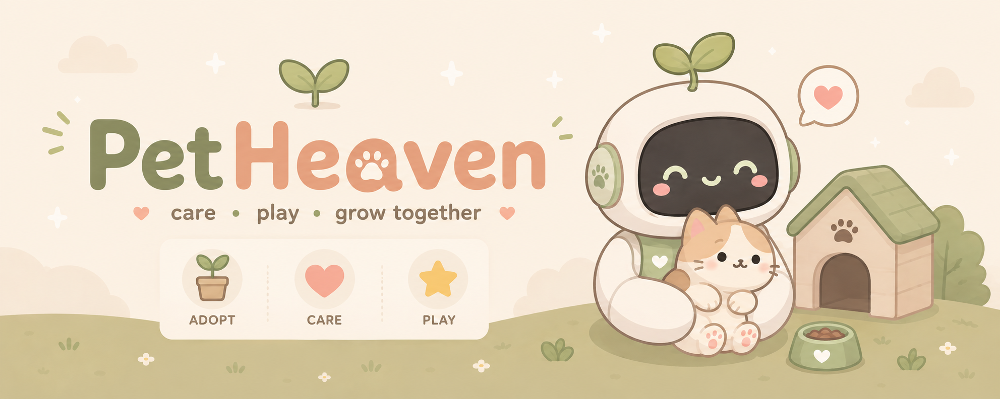

<div align="center">

# 🐾 Pet Haven

**Bot nuôi thú cưng ảo trên Discord**

*Nhận nuôi · Chăm sóc · Cùng lớn lên*

[](https://discord.js.org)
[](https://www.typescriptlang.org)
[](https://www.prisma.io)
[](https://nodejs.org)



</div>

---

## ✨ Về bot
s
Pet Haven cho phép người dùng Discord nhận nuôi thú cưng ảo, chăm sóc chúng hằng ngày và xây dựng cuộc sống riêng trong server. Thú cưng có cảm xúc thật — bỏ bê chúng và chúng sẽ buồn 🥺

📖 **[Đọc hướng dẫn chơi đầy đủ →](./GAMEPLAY.md)**

---

## 🐾 Thú cưng có thể nhận nuôi

| Tier | Loài | Icon |
|------|------|------|
| Cơ bản (2 pet đầu miễn phí) | Chó, Mèo, Hamster, Thỏ, Chim, Cá | 🐶 🐱 🐹 🐰 🐦 🐟 |
| Nâng cao (+50 vàng) | Rắn, Nhện, Chuột, Chồn | 🐍 🕷️ 🐀 🦡 |
| Huyền thoại (lv15 · +100 vàng) | Kỳ lân | 🦄 |

---

## ⚡ Tính năng nổi bật

- 🏠 **Đa nhà ở** — sở hữu nhiều căn, hệ thống slot mở theo level
- 📈 **Tiến trình** — cả chủ lẫn pet đều lên level, pet cao level tặng EXP bonus cho chủ
- 🔥 **Streak điểm danh** — duy trì liên tục để nhận thưởng bonus tối đa +50%
- 😊 **Hệ thống cảm xúc** — comfort & mood thay đổi theo cách bạn chăm sóc
- 🎮 **Mini-game** — Caro (XO) và Dò Mìn, tối đa 10 ván/ngày
- 🛒 **Shop & Inventory** — thức ăn mở theo level, autocomplete thông minh
- ⚙️ **Prefix tùy chỉnh** — mỗi server tự chọn prefix riêng (mặc định `p!`)

---

## 🎮 Lệnh

| Lệnh | Mô tả |
|------|-------|
| `/start` | Tạo hồ sơ người nuôi + nhận quà khởi đầu |
| `/adopt` | Nhận nuôi thú cưng mới |
| `/pets` | Danh sách thú cưng đang nuôi |
| `/profile` | Xem cấp độ, vàng, EXP, slot nhà |
| `/daily` | Điểm danh hằng ngày (có streak bonus) |
| `/feed` | Cho thú cưng ăn |
| `/petting` | Âu yếm thú cưng |
| `/inventory` | Kho thức ăn |
| `/shop food` | Mua thức ăn |
| `/shop house` | Mua / nâng cấp nhà |
| `/house list` | Xem nhà sở hữu |
| `/play` | Chơi XO hoặc Dò Mìn |
| `/leaderboard` | Bảng xếp hạng |
| `/help` | Hướng dẫn nhanh |
| `/setprefix` | Đổi prefix lệnh text *(Admin)* |

> Ngoài slash command, bot còn hỗ trợ prefix `p!` (ví dụ: `p!pets`, `p!feed`)

---

## 🚀 Cài đặt & Chạy

### Yêu cầu
- Node.js ≥ 20
- Discord Bot Token & Application ID

### Các bước

```bash
# 1. Clone repo & cài phụ thuộc
git clone <repo-url>
cd pet-haven
npm install

# 2. Tạo file .env từ mẫu
cp .env.example .env
# → Điền DISCORD_TOKEN, DISCORD_CLIENT_ID, DATABASE_URL

# 3. Khởi tạo database
npm run db:generate
npm run db:migrate
npm run db:seed

# 4. Đăng ký slash commands
npm run register

# 5. Chạy bot
npm run dev        # Development (hot-reload)
npm run start      # Production
```

---

## 🔧 Biến môi trường

| Biến | Bắt buộc | Mô tả |
|------|----------|-------|
| `DISCORD_TOKEN` | ✅ | Bot token từ Discord Developer Portal |
| `DISCORD_CLIENT_ID` | ✅ | Application ID của bot |
| `DATABASE_URL` | ✅ | Đường dẫn SQLite, ví dụ `file:./dev.db` |
| `DISCORD_GUILD_ID` | ⬜ | Guild ID để đăng ký lệnh nhanh khi dev |

---

## 🗂️ Cấu trúc dự án

```
src/
├── index.ts                  # Entry point
├── config/
│   ├── env.ts                # Đọc biến môi trường
│   └── game.ts               # Hằng số & balance cân bằng game
├── commands/
│   └── definitions.ts        # Định nghĩa slash commands
├── services/                 # Business logic
│   ├── player.service.ts
│   ├── pet.service.ts
│   ├── daily.service.ts
│   ├── minigame.service.ts
│   ├── shop.service.ts
│   └── experience.service.ts
├── games/
│   ├── tic-tac-toe.ts        # Logic Caro
│   └── mine-sessions.ts      # Logic Dò Mìn
├── interactions/
│   ├── command-handler.ts    # Router slash commands
│   └── button-handler.ts     # Router button / select menu
└── database/
    └── prisma.ts             # Prisma singleton
prisma/
├── schema.prisma
└── seed.ts
```
---

<div align="center">

Made with 💜 for Discord pet lovers

</div>

## Tính năng

- **Đa dạng pet**: chó, mèo, hamster + thỏ, chim, cá với nhiều giống + icon emoji riêng.
- **Chăm sóc hằng ngày**: cho ăn, âu yếm (+10 yêu thích, tối đa 5 lần/ngày), nhận EXP cho chủ và pet.
- **Tiến trình**: level chủ mở khóa thức ăn; level pet cao tăng % EXP bonus (tối đa +50%).
- **Điểm danh hằng ngày** (`/daily`): thưởng vàng + EXP, streak tăng bonus tối đa +50%.
- **Comfort & mood**: 3 trạng thái Buồn/Ổn/Vui vẻ; bỏ bê (quên cho ăn/pet vài ngày) bị trừ comfort.
- **Đa nhà ở**: sở hữu nhiều căn nhà theo slot cấp độ, tổng hợp sức chứa pet, comfort tối thiểu theo nhà xịn nhất. Không cần lệnh switch thủ công.
- **Kinh tế**: vàng, shop thức ăn/nhà, phí nhận nuôi (2 pet đầu miễn phí, từ pet thứ 3 phí 200 vàng), giới hạn thưởng chống farm.
- **Autocomplete** toàn diện cho `/feed`, `/petting`, `/shop`: gợi ý pet, thức ăn, nhà.
- **Mini-game**: XO (Caro) và Dò mìn — giới hạn 10 ván/ngày (từ ván 6 chỉ nửa thưởng).

